.. _sec_cross-section:

Cross-section Display Function
=================================

Overview
------------

When you use a solver that uses two-dimensional structured grids, iRIC can draw the attributes
along a grid line (for example, J = 1) as a cross-section.
This function is called the cross-section display function.

.. note:: Up to iRIC 4.0, only the cross-section of the input grid could be displayed. In iRIC 4.1 and later, the cross-section of calculation results can also be displayed.

:numref:`image_crosssection_window` shows an example.

This section explains how to use the cross-section display function.

.. _image_crosssection_window:

.. figure:: images/crosssection_window.png
   :width: 500pt

   Example of the cross-section window

Areas of the window
----------------------

This section explains each area of the cross-section window.

Toolbar
~~~~~~~~~~~~~~

The toolbar is displayed at the top of the window.

:numref:`image_crosssection_toolbar` shows an example of the toolbar.

.. _image_crosssection_toolbar:

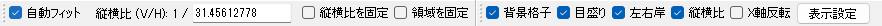

   Toolbar of the cross-section window

The functions of the toolbar are as follows.

Auto rescale
    When checked, the display range is adjusted so that all the data fits in the window
    when you switch the cross-section to display with the controller.

Aspect ratio (V/H)
    Specifies the ratio of the vertical scale to the horizontal scale.

Fix aspect ratio
    When checked, the aspect ratio is fixed when you change the scale by Ctrl + middle-dragging in the main area.

Fix region
    When checked, the functions to change the display region by Ctrl + left-dragging and Ctrl + middle-dragging
    in the main area are disabled.

Grid
    When checked, the background grid is displayed.

Scale
    When checked, the scales are displayed.

Left/right bank markers
    Displays the labels "Left Bank Side" and "Right Bank Side".

Aspect ratio
    Displays the aspect ratio in the main area.

Reverse X direction
    When checked, the direction of the horizontal axis is reversed.

Display Setting
    Opens the [Display Setting] dialog (refer to :numref:`image_crosssection_display_setting_dialog`).

.. _image_crosssection_display_setting_dialog:

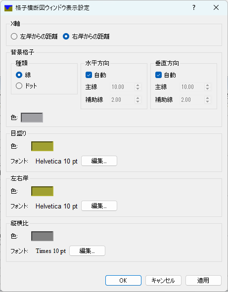

   The [Display Setting] dialog of the cross-section window

Value display setting area
-----------------------------

The value display setting area is displayed at the top right of the window.

:numref:`image_crosssection_value_display_setting` shows an example of the value display setting area.

.. _image_crosssection_value_display_setting:

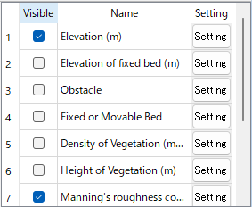

   Value display setting area of the cross-section window

The functions of the value display setting area are as follows.

Visible
    When checked, the value with that name is displayed in the main area.

Name
    Displays the name of the value.

Setting
    When you click on this button, the display setting dialog of the value with that name
    (refer to :numref:`image_crosssection_value_setting_dialog`) opens.
    The items in the dialog are as follows.

    Visible
        When checked, the value is displayed in the main area.

    Mode
        Select how to display the value from the following.

        Elevation chart
            Displays the value as a chart of elevation. :numref:`image_crosssection_elevation_chart` shows an example.
            Basically, this is used to display values such as elevation and water surface elevation.

        Independent chart
            Displays the value as a chart. The value is displayed in an independent chart, separately from elevation and other values.
            :numref:`image_crosssection_independent_chart` shows an example.

        Colormap
            Displays the value as bands colored differently for each value. This is mainly used to display flag values such as obstacle cells.
            :numref:`image_crosssection_colormap` shows an example.

    Elevation Chart Setting
        Enabled only when you select "Elevation chart" in [Mode]. You can set the line color, the line width,
        whether to show points, and whether to show indices.

    Independent Chart Setting
        Enabled only when you select "Independent chart" in [Mode]. You can set the chart height, the line color, etc.

.. note::

   In addition to the values defined at grid nodes, the values defined at cell centers
   and at grid edges (I-direction edges and J-direction edges) can also be displayed in the cross-section window.
   When a value defined at cell centers is displayed as an "Elevation chart", it is displayed as a step chart
   that draws a horizontal line for each cell.

.. _image_crosssection_value_setting_dialog:

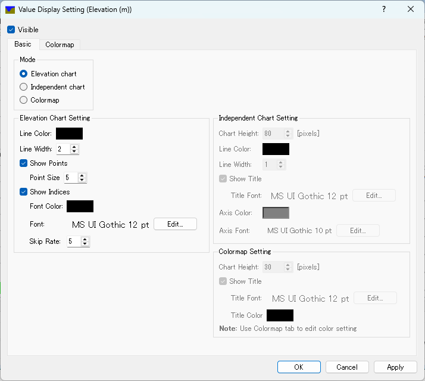

   Display setting dialog of a value in the cross-section window

.. _image_crosssection_elevation_chart:

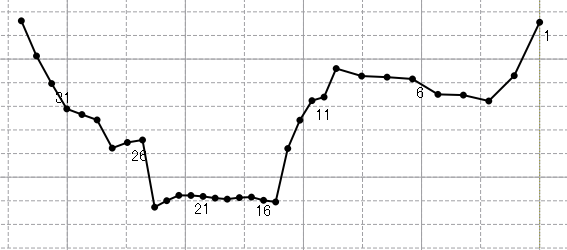

   Example of an elevation chart

.. _image_crosssection_independent_chart:

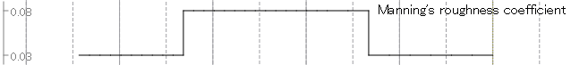

   Example of an independent chart

.. _image_crosssection_colormap:

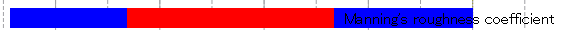

   Example of a colormap

Value display area
-------------------

The value display area is displayed at the bottom right of the window.

:numref:`image_crosssection_values` shows an example of the value display area. The values at the specified cross-section are displayed in this area.

.. _image_crosssection_values:

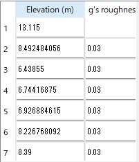

   Value display area of the cross-section window

Controller
-------------------

The controller is displayed at the bottom of the window.

:numref:`image_crosssection_controller` shows an example of the controller. You can change the region to display,
and perform other operations with the controller.

The functions of the controller are as follows.

Direction
    Specifies whether the horizontal axis of the cross-section window is the I direction or the J direction.

Position
    Specifies the position of the cross-section. For example, when the direction is the I direction and the position is 1,
    the cross-section at J = 1 is displayed.

Cell Values
    Specifies whether the cell on the upstream side or the cell on the downstream side of the cross-section line
    is displayed as the value at the cell center.

Snapshot
    Saves snapshots of the main area of the cross-section window. The dialog shown in :numref:`image_crosssection_snapshot` opens.
    Specify the destination folder and the cross-sections, and click on [OK].

CSV Export
    Saves the data displayed in the cross-section window to CSV files. The dialog shown in :numref:`image_crosssection_csvexport` opens.
    Specify the destination folder and the cross-sections, and click on [OK].

.. _image_crosssection_controller:

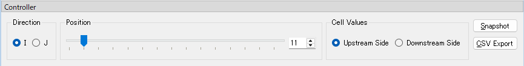

   Controller of the cross-section window

.. _image_crosssection_snapshot:

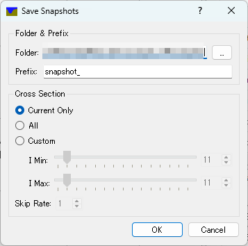

   Dialog to save snapshots of the cross-section window

.. _image_crosssection_csvexport:

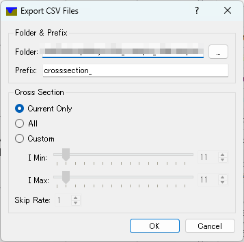

   Dialog to export CSV files of the cross-section window
