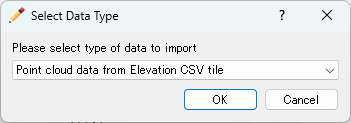
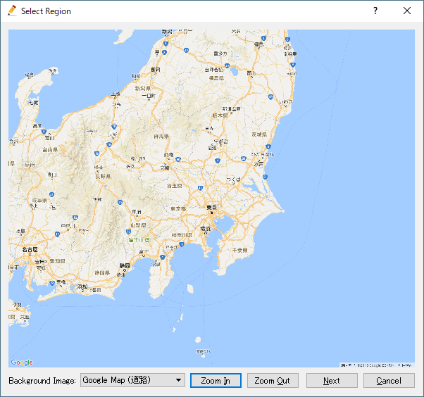
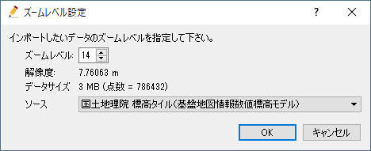
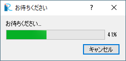
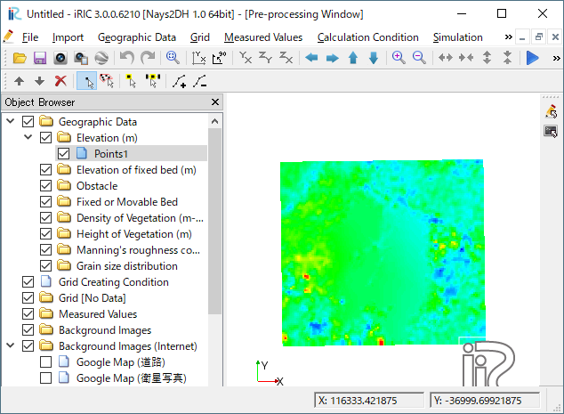
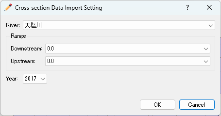

.. _sec_file_import_geo_data_from_web:

[Geographic Data (from web)]
================================

**Description**: Imports geographic data from web services

When you select this, the dialog to select the type of data to import
(refer to :numref:`image_geo_web_select_type_dialog`) is shown.

.. _image_geo_web_select_type_dialog:

   The dialog to select the type of data

Currently the following two types of data can be imported:

* Point cloud data generated from elevation CSV tiles
* Cross-section data of Hokkaido Regional Development Bureau

Each of them is explained below.

Point cloud data generated from elevation CSV tiles
-------------------------------------------------------

Please follow the steps below, to import the data.

1. In the dialog to select the type of data, select the point cloud data generated from elevation CSV tiles.

2. If you've not specified the coordinate system for the project,
   the [Select Coordinate System] dialog
   (:numref:`image_select_coordsystem_dialog`) is shown. Please select coordinate
   system and click on [OK] button.

3. [Select Region] dialog
   (:numref:`image_geo_web_select_region_dialog`) is shown.
   Use the following operations to select the region, and click on [Next]:

   * Ctrl + Left-dragging to Pan the map.
   * Ctrl + Middle-dragging to Zoom in/out the map. You also can use
     [Zoom In] and [Zoom Out] buttons.
   * Left-dragging to select region. The selected region is shown as a box with
     black line.

4. Click on [Next] button, and the [Zoom Level Setting] dialog is shown.
   In this dialog, you can change the setting like below:

   * You can select [Zoom level]. If you change the setting, you can review
     the abstract resolution and the size of data you are going to download,
     with [Resolution] and [Data size].
     The default value of the [Zoom level] is the maximum value, so that user
     usually use the data with the highest resolution.

   * You can select [Source]. By default, you can select the elevation tiles distributed by
     the Geospatial Information Authority of Japan (GSI) (DEM5A, DEM5B, DEM10B).
     When you want to use other sources, add them in the [Web Elevation Data] tab of the [Preferences] dialog.

     .. note::

        SRTM data distributed by USGS, which was included in the default sources in previous versions,
        has been removed from the default sources because it is no longer distributed.

5. Click on [OK], iRIC starts downloading, dialog in
   :numref:`image_geo_web_pleasewait_dialog` is shown.

6. When the downloading finishes, the dialog disappears, and the downloaded
   geographic data is shown like :numref:`image_geo_web_example`.

.. _image_geo_web_select_region_dialog:

   The [Select Region] dialog

.. _image_geo_web_select_zoomlevel_dialog:

   The [Zoom Level Setting] dialog

.. _image_geo_web_pleasewait_dialog:

   The [Please wait] dialog

.. _image_geo_web_example:

   Example of imported geographic data

Cross-section data of Hokkaido Regional Development Bureau
----------------------------------------------------------------

1. The [Cross-section Data Import Setting] dialog (refer to :numref:`image_geo_web_crosssection_dialog`) is shown.
   Specify the items and click on [OK]. The items are as follows.

   River name
       Select the river to import.

   Range
       Specify the KPs of the upstream end and the downstream end of the range to import.

   Year
       When survey results of multiple years exist, specify the year of the data to import.

2. The following operations are the same as importing a cross-section data file. Refer to :ref:`sec_geo_data_import_crosssection` for details.

.. _image_geo_web_crosssection_dialog:

   The [Cross-section Data Import Setting] dialog
