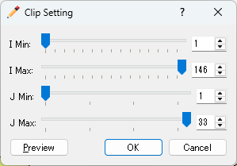

.. _sec_grid_clip:

Clip (C)
==============

**Description**: Clips a part of the grid, and replaces the grid with the clipped one.
Use this function when you want to remove unnecessary parts of the grid.

This function is available only for two-dimensional structured grids.
It is disabled for other types of grids, such as unstructured grids.

Clip the grid in the following steps.

#. In [Object Browser], select the grid (or [Grid Shape] under [Grid]) to clip.
#. Perform one of the following operations.

   **Menu bar:** [Grid] (G) --> [Clip...] (C)

   **Right-clicking menu:** Right-click on [Grid] in [Object Browser], and
   select [Clip...] (C) (refer to :numref:`image_grid_clip_menu`)

#. The [Clip Setting] dialog (:numref:`image_grid_clip_dialog`) opens.
   Specify the range to clip.
#. Click on [OK] to clip the grid.

.. _image_grid_clip_menu:

   The menu for clipping

In the [Clip Setting] dialog, specify the range to clip by the minimum and maximum node indices
in the I and J directions.
Move the sliders, or input values in the boxes on the right.

* I Min, I Max: Minimum and maximum node indices in the I direction of the range to clip
* J Min, J Max: Minimum and maximum node indices in the J direction of the range to clip

When you click on [Preview] (P), the range to be clipped with the current setting is displayed
as a thick black frame on the canvas. Check the range, and click on [OK].

.. _image_grid_clip_dialog:

   The [Clip Setting] dialog

In the clipped grid, the node coordinates, node attributes and cell attributes are
inherited only for the clipped range.

.. warning::

   When you clip the grid, the original grid is replaced with the clipped grid.
   This operation cannot be undone, and you also cannot undo the operations
   that were performed before it. We recommend saving the project before clipping.
