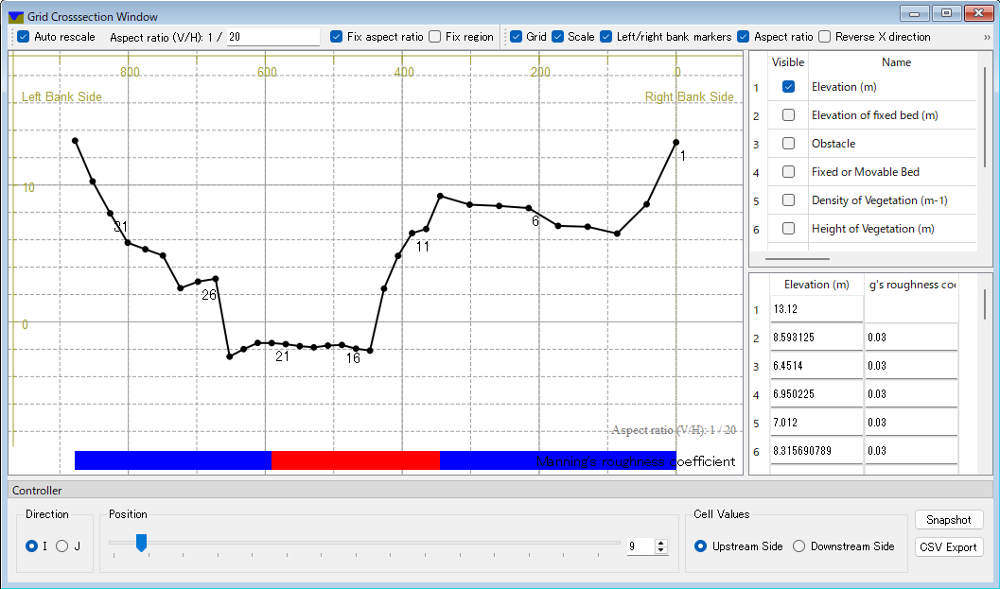

Grid Cross-section Window
==============================

When you select grid nodes and open the right-clicking menu on the canvas, the menu items
[Open Cross Section Window] and [Open Longitudinal Cross Section Window] are displayed.
When you select one of them, the grid cross-section window opens, and you can visualize the values of multiple attributes
at a specific cross-section at once.

:numref:`image_grid_crosssection_window` shows an example of the grid cross-section window.

Refer to :ref:`sec_cross-section` for details on how to use the grid cross-section window.

.. _image_grid_crosssection_window:

   Example of the grid cross-section window
