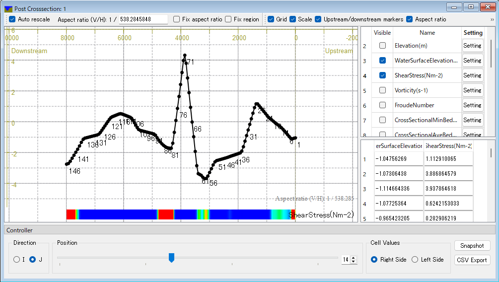

.. _sec_post_crosssection:

Cross-section Drawing Function
=================================

This section explains the function to draw the cross-sections of calculation results.

To use this function, use the cross-section window for calculation results.

Open a new cross-section window
-----------------------------------

Either of the following actions opens a new cross-section window.

**Menu bar:** [Calculation Results] (R) --> [Open New Cross-section Window]

**Operation Toolbar:** |cross-section-window-icon|

:numref:`image_post_crosssection_window` shows an example of the cross-section window that is displayed.

Refer to :ref:`sec_cross-section` for details on how to use the cross-section window for calculation results.

.. _image_post_crosssection_window:

   Example of the cross-section window
